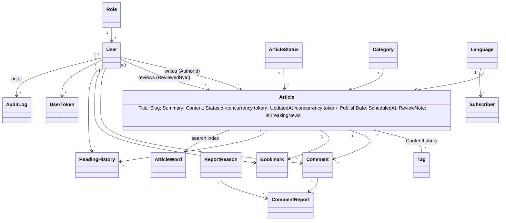
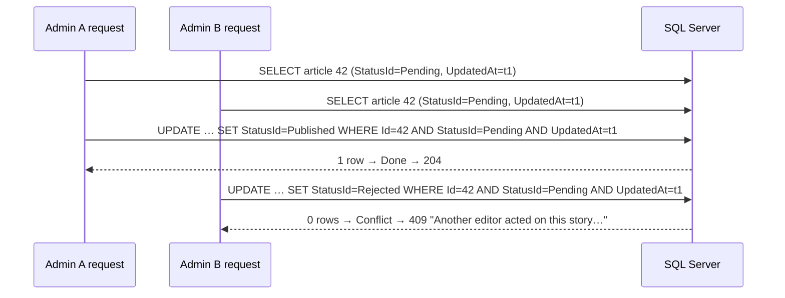
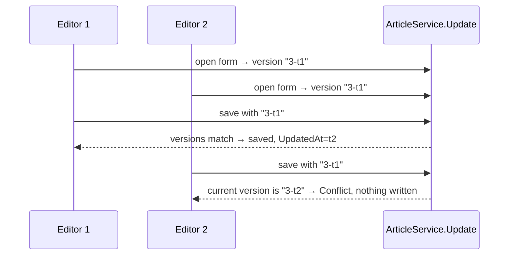

# 4+1 Views: The Meridian Newsfolio (W1 s8–9, Kruchten [4])

Every view below was checked against the code on branch `sadp/final-hardening`.

## Logical view (domain and classes)



Services in the logical view:

| Area | Services and contracts |
|---|---|
| Editorial | `IArticleService` → `ArticleService` + `ArticleBuilder` + `ArticleRules` |
| Discovery | `IArticleArchive` (also implemented by `ArticleService`), `SearchService`, `RecommendationService` |
| Comments | `CommentService` + `ModerationRules` |
| Accounts | `AuthService`, `UserService` |
| Newsletter | `NewsletterService` |
| Audit | `AuditService` |

## Process view (runtime and concurrency)

**Requests and threads.**
- Kestrel runs request work on threads from the .NET thread pool.
- **No thread is reserved for one request.** When an `async` step waits for I/O, its thread goes back to the pool, and the request continues later on any free pool thread [10].
- Most data access in this code base is synchronous EF Core (`ToList`, `SaveChanges`). During each such SQL call, the request keeps its current pool thread blocked.
- Under load the pool must then add threads. That is one *likely* reason why search latency grows with 20 concurrent users. It is a hypothesis, not a measured cause (`15` R-3).

**State per request and shared state.**
- Each request gets its own DI scope, with its own `NewsArchiveDbContext`. A `DbContext` is never shared between requests.
- Shared in-memory singletons:
  - `LoginThrottle`
  - `PasswordResetStore`, which uses a lock
  - `MemoryAppCache`
  - `DigestSender`

**Background work in the same process.**
- `ScheduledPublisher` is a `BackgroundService` that runs every 30 s, with a new scope each time. It calls `PublishDue()`, which is one atomic `UPDATE`, and then `IndexMissingSearchWords()`.
- `MaintenanceJob` runs every 24 h (and the same work runs once at start-up). It deletes expired API tokens, audit entries older than 365 days and stale unconfirmed sign-ups. The deletes are idempotent.
- `DigestSender` is a `BackgroundService` that reads a `Channel<DigestJob>`. It handles one edition at a time and refuses a second job for an edition that is still queued. Outside Development the admin page refuses to queue a digest, because email is disabled (ADR-007).
- **Sign-in lockout** (`LoginThrottle.Attempt`): a lock protects only the counter. A request reserves a slot before its password check and releases it afterwards, so parallel requests cannot exceed 5 checks per email and IP.

**Concurrency control (optimistic).**
- `Articles.StatusId` and `Articles.UpdatedAt` are EF Core concurrency tokens [8]. Every `UPDATE` of an article checks both values it originally read.
- An edit form carries a version (`StatusId` plus `UpdatedAt`), so a form opened before someone else saved is refused before anything is written.
- A refused write returns `ChangeResult.Conflict`:
  - MVC shows "Someone else changed this article…" or "Another editor acted on this story…".
  - The API answers 409 with the same text. An ordinary wrong state, such as rejecting a story that is already published, keeps its own message.

**Caches and stale reads.**
- Listing caches (trending, section counts, popular tags, recommendation lists) live up to 2 minutes.
- Every publish, edit, delete and schedule change clears the content region *after* the database write succeeds.
- A list that was being built while the region was cleared is stored under the old version key, so it is never served again (`MemoryAppCacheTests`).

**Approval race (tested):**



**Stale edit form (tested):**



## Development view (modules and build)

```text
NewsArchiveSolution/NewsArchiveSolution.slnx
├── DAL/                 EF/ (DbContext, Tables, Migrations), Interfaces/, Repos/, DataAccessFactory, DataLayerServices
├── BLL/                 Services/, Rules/, Builders/ArticleBuilder, Interfaces/ (incl. IArticleArchive), DTOs/, Mapping/, Security/, Audit/, Caching/, Email/, Media/
├── NewsArchive/         Controllers/ (+Api/), Filters/, Auth/, Email/, Publishing/, Seo/, Views/, Resources/ (bn), wwwroot/, Program.cs
└── NewsArchive.Tests/   Rules/, Services/, Security/, Patterns/, Integration/ (WebApplicationFactory), Support/
tools/smoke/smoke.py     end-to-end smoke test and search benchmark on a disposable database
```

- Compile-time rule: UI → BLL → DAL. The DAL is hidden from the UI with `PrivateAssets="compile"`.
- Build: `dotnet build -c Release`.
- CI: `.github/workflows/build.yml` runs on every push and pull request to `develop` and `main`: restore, build, then all tests against a SQL Server 2022 container (137 tests on this branch), then the vulnerable-package report.

## Physical view (deployment and nodes)

| Environment | Nodes |
|---|---|
| Development (verified) | One Windows 11 laptop runs Kestrel (`dotnet NewsArchive.dll`, port 5096 or 5199) and SQL Server 2025 Express on the same machine. Pictures are kept on the local disk (`wwwroot/uploads`); emails are written to `App_Data/outbox`. |
| CI (verified on GitHub) | GitHub-hosted Ubuntu runner plus a SQL Server 2022 container (port 1433). |
| Production (planned, not deployed) | One app host (Azure App Service or IIS) behind the host's HTTPS front end (`Hosting:TrustAllProxies=true`), one managed SQL database, persistent storage for uploads. No mail provider: email is disabled outside Development. **Not deployed.** |

## +1 Scenarios (each one crosses all four views)

| # | Scenario | Logical | Process | Development | Physical | Verified by |
|---|---|---|---|---|---|---|
| S1 | Author submits, admin approves, reader reads | Article, ArticleBuilder, ArticleRules.CanView | 3 separate requests, each with its own scope | Api/ArticlesApiController → ArticleService → ArticleRepo | Browser → Kestrel → SQL Server | `AppTests.Author_submission_stays_hidden_…`; smoke |
| S2 | Two admins decide the same story | StatusId and UpdatedAt tokens, `ChangeResult` | Two concurrent scopes; optimistic check | `Repository.Update` catch | One SQL row | `AppTests.Two_reviewers_cannot_…`, `A_decision_racing_another_editor_…` |
| S3 | Scheduled story goes live | Scheduled → Published | Background job every 30 s | `Publishing/ScheduledPublisher` | Same process | Smoke: live after 85 s |
| S4 | Reader searches "নদী river" | ArticleWord index, SearchRules | One request | ArticleRepo.Search | SQL index seek on `PK_ArticleWords` | `AppTests.Search_finds_…`; 5,000-story benchmark |
| S5 | Visitor subscribes; admin sends the digest (offline) | Subscriber, EmailSender | Request plus background queue | NewsletterController, DigestSender, OutboxEmailSender | Private outbox file (Development); disabled elsewhere | `HardeningTests.Newsletter_double_opt_in_works_offline…`, `Outside_development_mail_is_disabled…`; smoke outbox checks |
| S6 | Two editors save the same story from old forms | Article version | Two requests, version check then token check | `ArticleService.Update`, `_ArticleForm` hidden field | One SQL row | `AppTests.An_edit_from_a_stale_form_…`; smoke (API and MVC) |
