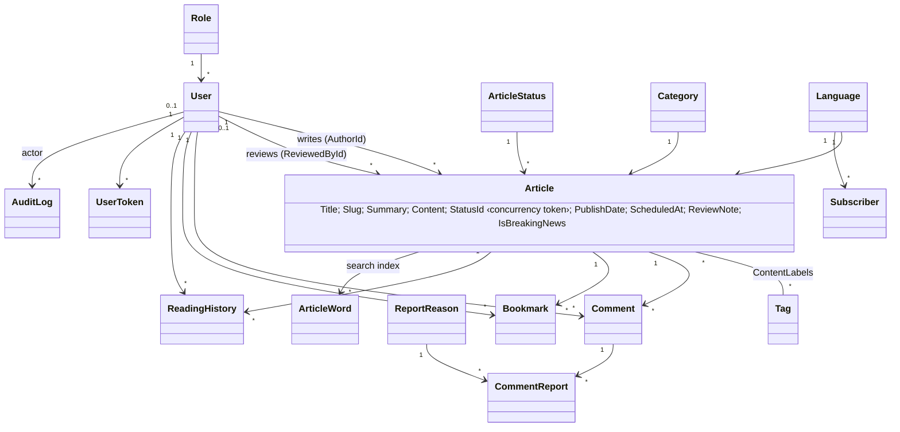
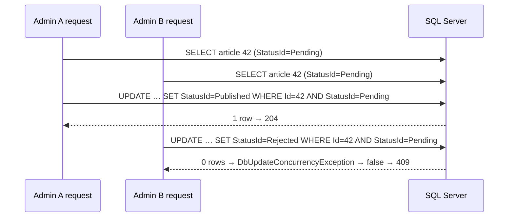

# 4+1 Views: The Meridian Newsfolio (W1 s8–9)

Every view below comes from the code at branch `sadp/midterm-readiness`.

## Logical view (domain and classes)



Services in the logical view:

| Area | Services |
|---|---|
| Editorial | `ArticleService` + `ArticleBuilder` + `ArticleRules` |
| Discovery | `SearchService`, `RecommendationService` |
| Comments | `CommentService` + `ModerationRules` |
| Accounts | `AuthService`, `UserService` |
| Newsletter | `NewsletterService` |
| Audit | `AuditService` |

## Process view (runtime and concurrency)

- **Requests.** Kestrel serves each HTTP request on a thread-pool thread. Each request gets its own DI scope with its own `NewsArchiveDbContext`; scoped lifetime, never shared.
- **Shared in-memory singletons:**
  - `LoginThrottle`
  - `PasswordResetStore`, which uses a lock
  - `MemoryAppCache`
  - `DigestSender`
- **`ScheduledPublisher`.** A `BackgroundService` that runs every 30 s with its own scope. It calls `PublishDue()` (one atomic UPDATE) and `IndexMissingSearchWords()`.
- **`DigestSender`.** A `BackgroundService` that consumes a `Channel<DigestJob>`. It handles one edition at a time and refuses a second job for an edition that is still queued.
- **Concurrency control.** Optimistic: `Articles.StatusId` is a concurrency token, so a stale review decision gets 0 rows, then `false`, then 409.

Approval race (tested):



## Development view (modules and build)

```text
NewsArchiveSolution/NewsArchiveSolution.slnx
├── DAL/                 EF/ (DbContext, Tables, Migrations), Interfaces/, Repos/, DataAccessFactory, DataLayerServices
├── BLL/                 Services/, Rules/, Builders/ArticleBuilder, DTOs/, Mapping/, Security/, Audit/, Caching/, Email/, Media/
├── NewsArchive/         Controllers/ (+Api/), Filters/, Auth/, Email/, Publishing/, Seo/, Views/, Resources/ (bn), wwwroot/, Program.cs
└── NewsArchive.Tests/   Rules/, Services/, Security/, Patterns/, Integration/ (WebApplicationFactory), Support/
```

- Compile-time rule: UI → BLL → DAL. The DAL is hidden from the UI with `PrivateAssets="compile"`.
- Build: `dotnet build -c Release`.
- CI: `.github/workflows/build.yml` runs restore, build, all 108 tests against a SQL Server 2022 container, then the vulnerable-package report.

## Physical view (deployment and nodes)

| Environment | Nodes |
|---|---|
| Development (verified) | One Windows 11 laptop runs Kestrel (`dotnet NewsArchive.dll`, port 5096 or 5199) and SQL Server 2025 Express on the same machine. Pictures sit on the local disk (`wwwroot/uploads`); emails are written to `App_Data/outbox`. |
| CI (verified on every push) | GitHub-hosted Ubuntu runner plus a SQL Server 2022 container (port 1433). |
| Production (planned, not deployed) | One app host (Azure App Service or IIS) behind the host's HTTPS front end (`Hosting:TrustAllProxies=true`), one managed SQL database, persistent storage for uploads, an SMTP provider. **Not deployed in this task.** |

## +1 Scenarios (each one crosses all four views)

| # | Scenario | Logical | Process | Development | Physical | Verified by |
|---|---|---|---|---|---|---|
| S1 | Author submits, admin approves, reader reads | Article, ArticleBuilder, ArticleRules.CanView | 3 separate requests, each with its own scope | Api/ArticlesApiController → ArticleService → ArticleRepo | Browser → Kestrel → SQL Server | `AppTests.Author_submission_stays_hidden_…`; smoke |
| S2 | Two admins decide the same story | StatusId token | Two concurrent scopes; optimistic check | `Repository.Update` catch | One SQL row | `AppTests.Two_reviewers_cannot_both_decide_…`; smoke 409 |
| S3 | Scheduled story goes live | Scheduled → Published | Background job every 30 s | `Publishing/ScheduledPublisher` | Same process | Smoke: live after 85 s |
| S4 | Reader searches "নদী river" | ArticleWord index, SearchRules | One request | ArticleRepo.Search | SQL index seek on `PK_ArticleWords` | `AppTests.Search_finds_…`; benchmark |
| S5 | Visitor subscribes; admin sends the digest | Subscriber, EmailSender | Request plus background queue | NewsletterController, DigestSender, EmailSender | Outbox file (dev) or SMTP | `NewsletterServiceTests`, `EmailSenderTests`; smoke outbox file |
