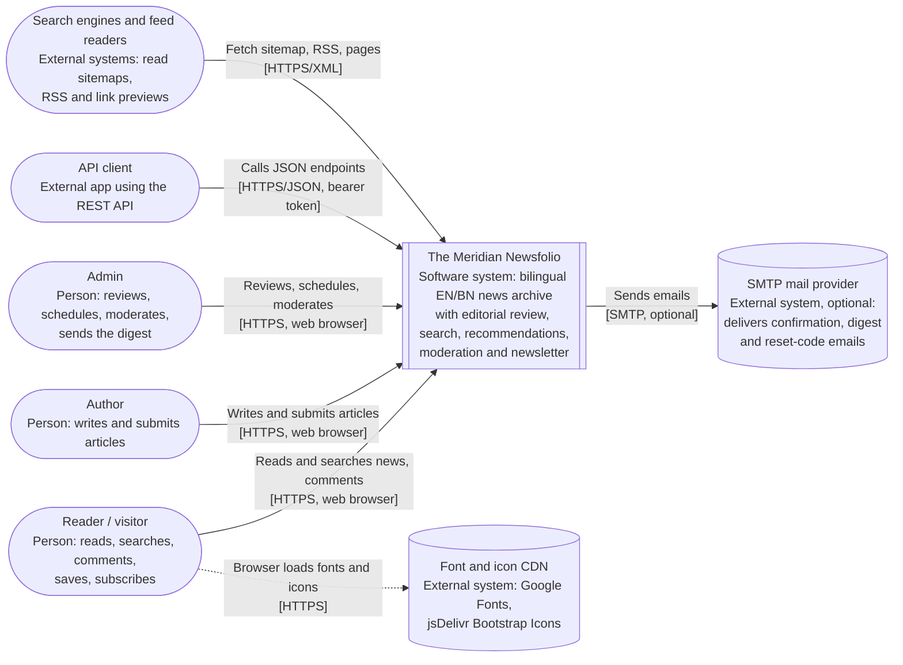
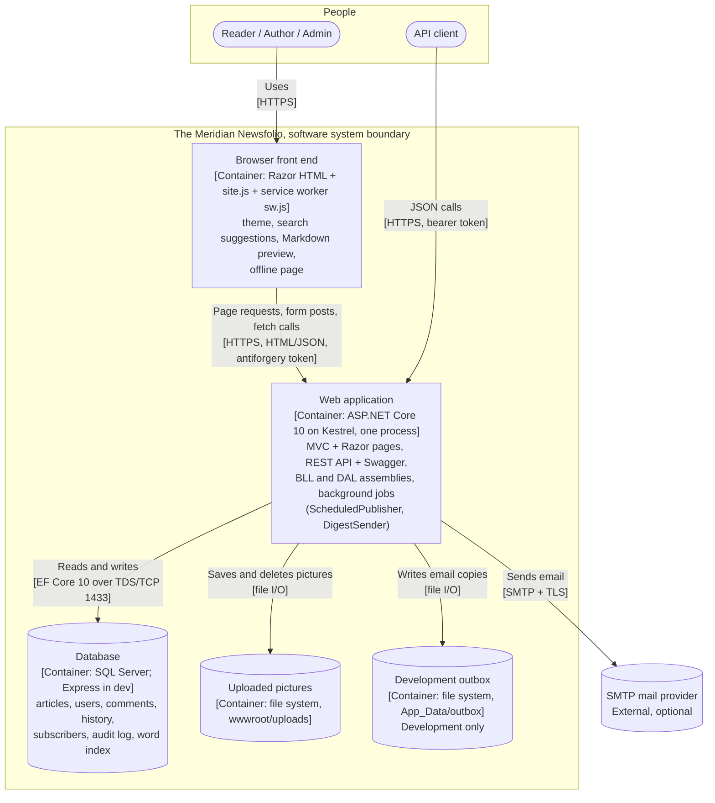
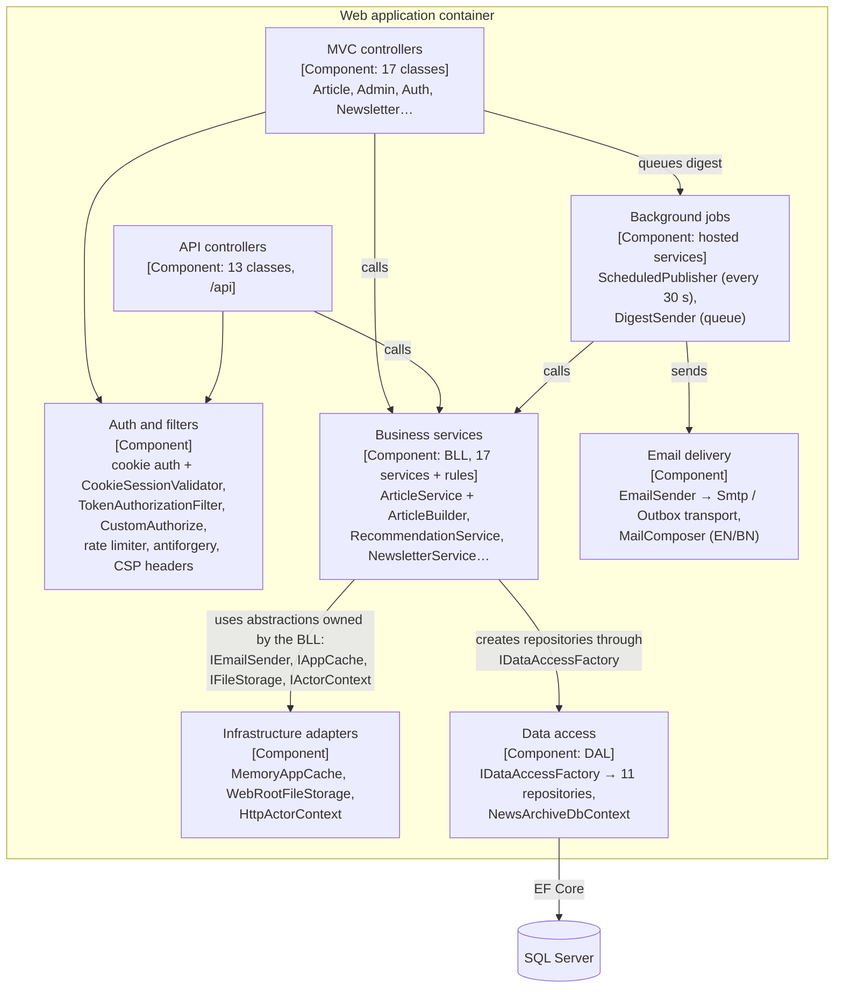

# C4 Diagrams: The Meridian Newsfolio

These diagrams are kept as code (Mermaid), in the spirit of W12 s14. GitHub renders them. Each one states its level, title and key, and every arrow says *what* and *how* (W2 s24–25).

**For the midterm report (§4) use Level 1.** Level 2 is for the proposal or a viva question. Level 3 is for the Week 12 checkpoint (W12 s11: "three diagrams (C1–C3) is the checkpoint requirement").

**Rendered images:** not produced. No Mermaid renderer is installed, and nothing was installed. Paste the code into mermaid.live or view it on GitHub to export PNG or SVG.

## Level 1: System Context

Why this view (two lines for §4):
- It shows the whole Newsfolio as one box, with every kind of user and every outside system it depends on. Anyone can read it in a minute (W2 s23).
- It fixes the system boundary before any technology talk. That matters here, because three roles share one system and email is the only outside dependency.

Key:
- `([...])` = person or outside actor.
- `[[...]]` = the system in scope.
- `[(...)]` = external system.
- A dotted arrow means the browser, not the server, makes the call.

## Level 2: Containers

Notes that keep this diagram honest:
- **UI, BLL and DAL are not separate containers.** They are three assemblies loaded into one process, so they appear inside "Web application" and in Level 3.
- **The MVC website and the REST API are the same deployable,** so they are one container.
- **SQL Server** is a separate process, and in production normally a separate host.

## Level 3: Components inside the web application (Week 12 checkpoint)

