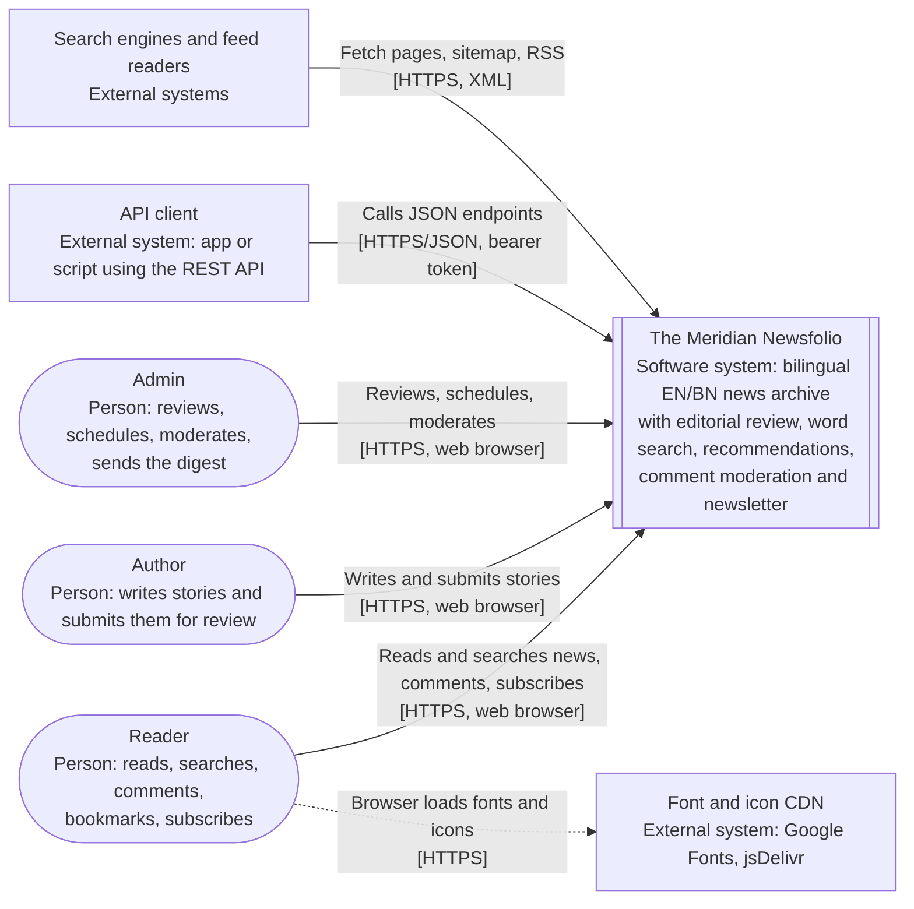
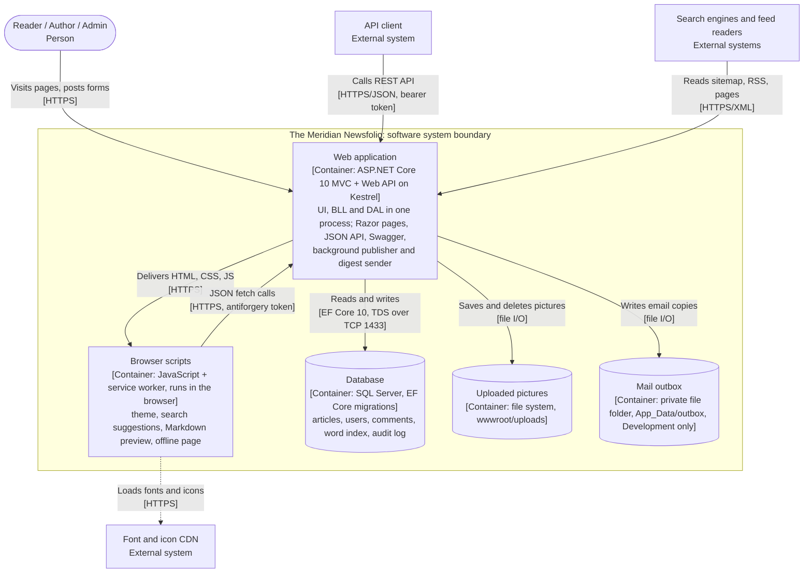
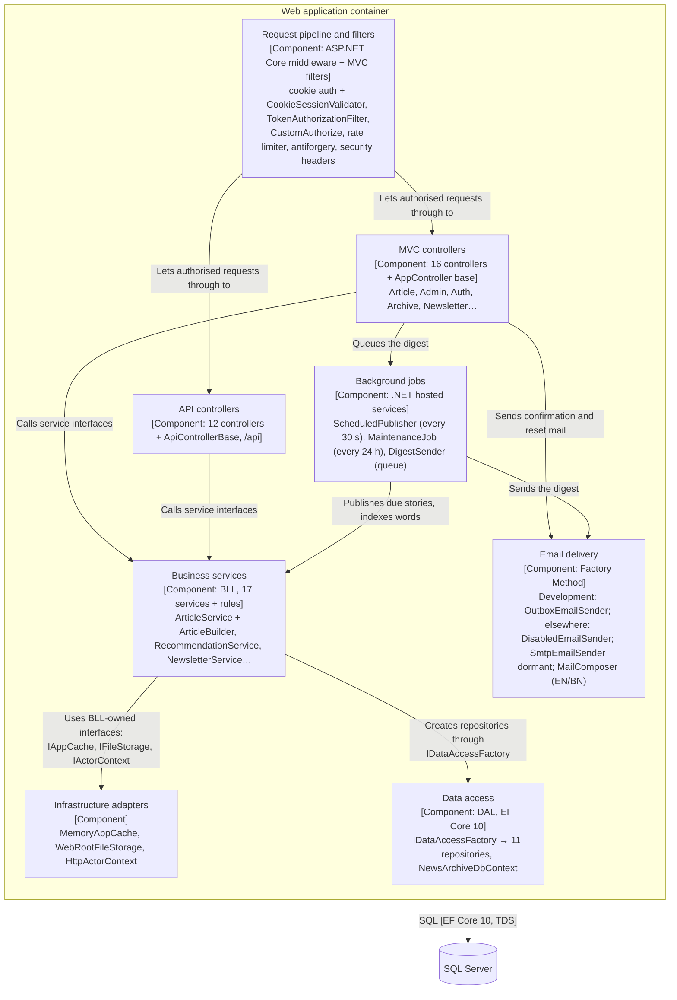

# C4 Diagrams: The Meridian Newsfolio

**Where each level is used:**

| Level | Used in | Rendered file |
|---|---|---|
| Level 1 | Midterm §4 (Figure 1) | `c4_level1_context.png` (and `.svg`) |
| Level 2 | Project Proposal §8 | `c4_level2_containers.png` (and `.svg`) |
| Level 3 | Week 12 checkpoint only | Mermaid below (not exported) |

**How the images are made.**
- `render_c4.py` writes the SVG files with the Python standard library.
- It then makes the PNG files with the local Chrome (or Edge) in headless mode, at 2× scale.
- Nothing was installed for this. To rebuild them: `python sadp_delivery/09_C4_AND_4PLUS1/render_c4.py`.
- Both PNG files were opened and checked by eye: every box, arrow, label and the key are readable, and nothing overlaps.

The Mermaid sources below match the images. They are kept as text so the diagrams can be reviewed in a pull request.

**Notation (C4):**
- Every element shows its name, its type in brackets, and a short description.
- Every arrow says *what* happens and, in brackets, *how* (protocol or technology).
- A dotted arrow is a call made by the reader's browser, not by our server.

## Review against C4 rules

| Check | Level 1 | Level 2 |
|---|---|---|
| Scope stated | The whole software system | Containers inside the system boundary |
| System boundary shown | The system is one box | Dashed boundary around 5 containers |
| Element types labelled | Person / Software System / External System | Person / Container / External System |
| Technology shown | Only on arrows (L1 has no technology inside the system) | On every container and on every arrow |
| Arrows labelled with intent and protocol | Yes (6) | Yes (9) |
| Key | Yes | Yes |

**Corrections made in this revision:**
- **Level 2, browser scripts.** This container is now *delivered by* the web application. Before, it was drawn as if it were deployed on its own. It is a real container because its code runs in a different place: the reader's browser, including the service worker.
- **Level 2, CDN.** The font and icon CDN was added, because the browser scripts call it.
- **SMTP removed (final hardening).** The app never connects to a mail provider (ADR-007), so the SMTP external system and its arrow were removed from L1 and L2. A note on each figure says that real email is not implemented and that Development writes to a private outbox.
- **Level 3.** The auth filters are drawn as running *before* the controllers. Before, they were drawn as something the controllers call. Every arrow now has a label.
- **Not containers:** UI, BLL and DAL are three assemblies loaded into one process. The MVC site and the REST API are the same deployable. So they are one container, and the layers appear only at Level 3.

## Level 1: System Context

**Why this view (two lines for midterm §4):**
- It shows the whole Newsfolio as one box, with every kind of user and every outside system it depends on. Anyone can read it in a minute [6], [9, L2].
- It fixes the system boundary before any technology talk. That matters here, because three roles share one system and our server calls no outside service: fonts load in the browser, and real email is not implemented.

## Level 2: Containers

**Why this view (for the proposal):** it shows which parts run separately and with what technology. It also makes clear that the three layers are *not* three tiers: they run in one process.

## Level 3: Components inside the web application (Week 12 checkpoint)

