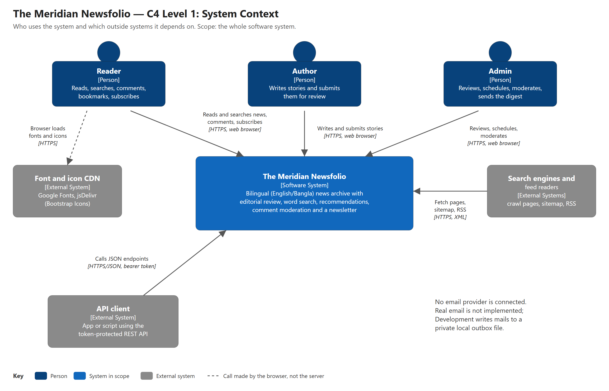

# CSC 4273 — Mid-Term Case Study Report (DRAFT FOR REVIEW)

This draft follows the official template in P2 p3–5 and uses only Lectures 1–3 [9].

**Legend:**
- **[CONFIRMED]**: backed by the code or a test. Paths are relative to `NewsArchiveSolution/`, on branch `sadp/final-hardening`.
- **[TBD]**: personal or group data that is still missing. It is never invented here.
- **Status words in §3:** VERIFIED = an automated test enforces it; MEASURED = a number produced in this work; TARGET = a goal not yet measured; NOT VERIFIED = cannot be checked without a deployment.

| Field | Entry |
|---|---|
| Project topic (system) | The Meridian Newsfolio: a bilingual (English/Bangla) news archive with editorial review |
| Group no. & section | [TBD] |
| Team members (ID — Name) | [TBD] (the repository belongs to GitHub account `sadatnuman`; the group must confirm every name and ID) |
| Submission date | [TBD] |
| Outcome | CO1 — Analyze quality attributes and trade-offs (with CO3) |

## 0 · Project Topic & Work-Split (GROUP)

The Meridian Newsfolio lets authors write news in English or Bangla, lets admins review, schedule and moderate it, and lets readers search, read and get recommendations. It is one ASP.NET Core application over SQL Server [CONFIRMED].

| Member (ID — Name) | Owns feature / module | NFA they achieve (§3) | SOLID (§6) + creational pattern (§9) |
|---|---|---|---|
| [TBD] — [TBD] (M1) | Editorial workflow: write, submit, review, schedule, edit | Reliability: no lost decision, no lost edit | SRP · Builder (`ArticleBuilder`) |
| [TBD] — [TBD] (M2) | Accounts & security: sign-in, lockout, reset, roles, API tokens | Security: lockout, CSRF, role checks | DIP · Singleton (DI-managed single instance) |
| [TBD] — [TBD] (M3) | Newsletter & email delivery (offline: local outbox in Development, disabled elsewhere) | Availability: a mail failure or disabled mail never breaks a page | OCP · Factory Method (`EmailSender.CreateTransport`) |
| [TBD] — [TBD] (M4) | Discovery: search, date archive, recommendations | Performance: search latency | ISP (`IArticleArchive`) · Abstract Factory (`IDataAccessFactory`) |

For 2, 3 or 5 members, see `13_MEMBER_WORK_SPLIT_AND_VIVA.md`.

## 1 · Architecture vs. Design (GROUP, Q1)

**Rule used** [9, L1 s5–6], [1]: a decision is *architectural* when reversing it is costly and the change reaches many modules or the deployment. It is *design* when it is local and cheap to change.

| Architectural decision (hard to reverse) | Why it is architectural |
|---|---|
| A1: One deployable modular monolith in three layers (UI → BLL → DAL), enforced at compile time (`BLL/BLL.csproj:14`) | Changing it changes the deployment, the CI pipeline, and how every feature reaches data |
| A2: SQL Server with EF Core migrations as the single system of record | Changing it needs a data migration and touches every repository |
| A3: Identity model: cookie sign-in for the website, plus opaque random API tokens stored as hashes for apps (`BLL/Services/AuthService.cs:101`) | Every endpoint and every client depends on it |

| Design decision (cheap to revisit) | Why it is design |
|---|---|
| D1: `ArticleBuilder` builds new articles (`BLL/Builders/ArticleBuilder.cs`) | Local to the editorial module; callers would not notice a refactor |
| D2: `EmailSender` with the factory method `CreateTransport()` | Local to email delivery |
| D3: Search tokenizer and the 2-minute listing-cache lifetime | One class or one constant to change |

## 2 · Architectural Style & Why (GROUP, Q2)

**Primary style.** Layered (N-tier) [9, L2 s6–7], with MVC in the presentation layer [9, L2 s11], in a client–server setting. Browsers and API clients talk to one server over HTTPS; the server talks to SQL Server [CONFIRMED].

**Dependencies flow downward only:** Controller → Service → `IDataAccessFactory`/Repository → `DbContext`. Checks:
- 0 UI→DAL references.
- 0 DAL→BLL references.
- 0 HTTP types in the BLL.

**Monolith vs SOA: a modular monolith.** Our drivers match the "monolith best for" row [9, L2 s29]:
- a team of 2–5 students;
- under 10,000 expected users;
- heavily shared data (articles, users, comments, history);
- review decisions that need strong consistency, which one ACID database gives simply;
- one host.

SOA or microservices were rejected. Separate pipelines, data ownership and network calls would cost more than the team can run, before any module has a real need to scale on its own [9, L2 s30], [12].

**Layers are not physical tiers.** UI, BLL and DAL run in one process; only the database is separate (Figure 1).

## 3 · Non-Functional Attribute & How (INDIVIDUAL, Q3)

Each member owns one quality attribute [1], [9, L1 s27–39]:

| Member | Quality attribute | Measurable target | How the design achieves it | Status |
|---|---|---|---|---|
| M1 [TBD] | Reliability | (a) When two admins decide the same pending story, exactly 1 decision is stored and the other admin is told so. (b) An edit saved from an out-of-date form never overwrites a newer edit. (c) A scheduled story goes live once, ≤ 60 s after its time. | Optimistic concurrency [8]: `StatusId` and `UpdatedAt` are concurrency tokens (`DAL/EF/NewsArchiveDbContext.cs:91–92`). The edit form carries a version (`BLL/Services/ArticleService.cs:89`). A conflict becomes `ChangeResult.Conflict`, which the API answers with 409. Scheduled stories go live in one atomic `UPDATE` (`DAL/Repos/ArticleRepo.cs:259`). | (a), (b) VERIFIED by `AppTests` (4 tests) and by smoke over the API and the MVC form. (c) MEASURED: live 85 s after a schedule set 75 s ahead. |
| M2 [TBD] | Security | 0 unpublished stories readable by the public. At most 5 password checks per email+IP per 15 min, **even with 20 requests sent at once**. 100 % of form POSTs need an antiforgery token. Passwords use PBKDF2-SHA256 with 100k iterations. | `ArticleRules.CanView`; `LoginThrottle.Attempt` reserves a slot under a lock before the password check (`NewsArchive/Auth/LoginThrottle.cs:41-47`); `AutoValidateAntiforgeryToken` (`Program.cs`); `PasswordHasher` (`BLL/Security/PasswordHasher.cs:9`). | VERIFIED by `SecurityTests` (20 parallel attempts → exactly 5 checks) and `HardeningTests` (12 parallel API attempts → 5 × 401, 7 × 429, then the website is locked too); `AppTests` (missing token → 400, roles → 401/403, hidden pending story → 404). |
| M3 [TBD] | Availability (failure isolation, offline) | A failing transport, a bad address or disabled email cause 0 failed page requests; `SendAsync` never reports a mail as sent when it was not; 2,000 disabled sends add 0 warning logs. | `EmailSender.SendAsync` contains every delivery error and returns `false` (`NewsArchive/Email/EmailSender.cs`). Outside Development the app registers `DisabledEmailSender`, which returns `false` without any transport (`Program.cs:111-115`). The digest runs in the background `DigestSender`. | VERIFIED by `EmailSenderTests` (5) and `HardeningTests.Outside_development_mail_is_disabled…` (2,000 sends, no SMTP socket). Real email delivery is **not implemented** (owner's decision), so deliverability is not measured. Uptime (99.5 %) is NOT VERIFIED: no deployment. |
| M4 [TBD] | Performance | Search page p95 ≤ 200 ms for 1 user and ≤ 1 s for 20 concurrent users, on one server, with ≥ 5,000 stories. | `ArticleWords` word index (prefix seek), list projection without the article body, caches. | MEASURED on a laptop with 5,024 published stories (final run): 1 user p95 = 66.9 ms; 20 users p95 = 784.2 ms (38.9 req/s, 0 errors). Both latency targets met on this machine; not measured on production hardware. |

**The other two attributes (group view, same status words):**
- **Scalability.** One instance serves 20 concurrent readers with 0 errors: MEASURED (38.9–43.0 req/s over three runs; the ≥ 40 req/s goal was missed in the final run). Running 2+ instances: TARGET, blocked by in-memory lockout, reset-code and cache state.
- **Maintainability.** 0 reverse layer dependencies, VERIFIED by the compiler. 137 automated tests pass (run locally on this branch; CI runs the whole suite on every push and pull request to `develop` and `main`): VERIFIED.

## 4 · C4 Diagram & Why (GROUP, Q4)

*Figure 1. C4 Level 1: System Context of The Meridian Newsfolio [6].*

**Why this view:**
- It shows everyone who uses the Newsfolio and every outside system it depends on, on one page that a non-technical reader understands in a minute [6], [9, L2 s23].
- It fixes the system boundary before any technology detail: our server calls no outside service (real email is not implemented), and fonts are loaded by the browser.

## 5 · 4+1 View Model (GROUP, Q5)

Views as defined by Kruchten [4], [9, L1 s8–9]:

| 4+1 view | Our system in this view |
|---|---|
| Logical | Article (status, schedule and review fields), User/Role, Category, Tag, Comment/CommentReport, Bookmark, ReadingHistory, Subscriber, AuditLog, ArticleWord. Services: `ArticleService` + `ArticleBuilder` + `ArticleRules`, the archive contract `IArticleArchive`, Search/Recommendation, Comment, Auth, Newsletter, Audit. |
| Process | Requests run on .NET thread-pool threads. No thread is reserved for one request: an `async` step releases its thread while it waits, and continues on any free thread [10]. Our data access is mostly synchronous EF Core, so each SQL call blocks the current pool thread for its duration. Each request has its own DI scope and `DbContext`. Shared single instances: lockout store, reset codes, cache. A background job every 30 s publishes due stories; a daily job removes expired data; a background queue handles digests (Development outbox only). Optimistic concurrency protects review decisions and edits. |
| Development | `NewsArchiveSolution.slnx`: DAL (EF, repositories, migrations) ← BLL (services, rules, builders) ← NewsArchive (MVC + API + Razor), plus NewsArchive.Tests. CI builds and runs every test on each push and pull request to `develop` and `main` (137 tests on this branch). |
| Physical | Dev: one laptop with Kestrel and SQL Server Express; local disk for uploads and the email outbox. CI: GitHub Ubuntu runner plus a SQL Server 2022 container. Planned production: one app host plus a managed SQL database (not deployed). |
| Scenarios | S1 author submits → admin approves → reader reads. S2 two admins race on one story. S3 a scheduled story goes live. S4 bilingual search. S5 subscribe and digest (offline outbox). S6 two editors save from old forms. Each is traced through all four views and tested (`09_C4_AND_4PLUS1/4PLUS1_VIEWS.md`). |

## 6 · SOLID in a Feature (INDIVIDUAL, Q6)

Principles as defined in [3], [9, L1 s10–26]:

| Member | Feature | SOLID principle | How it is applied & why |
|---|---|---|---|
| M1 [TBD] | Article creation and review | SRP | Construction and its rules live in `ArticleBuilder`; workflow, audit and cache in `ArticleService`; policy in `ArticleRules`. A change to a status rule touches one class. |
| M2 [TBD] | Password change | DIP | `PasswordChanger` depends on the `IAuthService` abstraction (`NewsArchive/Auth/PasswordChanger.cs:15`), so its test injects a fake and needs no database. |
| M3 [TBD] | Email delivery | OCP | A new channel is a new `EmailSender` subclass plus a transport. Its callers (newsletter, auth, digest) stay unchanged. |
| M4 [TBD] | Date archive | ISP | The archive pages, the archive API and the sitemap need only 3 operations (month list, day counts, stories in a period). They now depend on `IArticleArchive` with exactly those 3 members (`BLL/Interfaces/IArticleArchive.cs`), not on the 26-member `IArticleService`. Why: a change to editorial methods can no longer force the archive clients to change, and a test swaps in a 3-method stub to serve the archive pages (`AppTests.Archive_pages_depend_only_on_the_narrow_archive_contract`). |

## 7 · CAP Trade-off (GROUP, Q7)

**Most critical data.** An article's editorial status: whether a story may be public.

**Today.** One SQL Server node, with ACID transactions and optimistic concurrency checks. There is no replica, so there is no network partition to choose about. ACID consistency is not CAP consistency [9, L1 s41], [7].

**Design decision for replication: CP for editorial status.** During a partition, approve, reject, schedule and edit are refused with an error rather than written to a copy that may be stale [5]. A story that was rejected or never reviewed must never reach readers; that matters legally and for trust. A delayed approval only costs minutes.

**AP for reading.** Pages, search, recommendations and view counts may be a little stale. Being unavailable would lose readers, while staleness harms no one. One limit keeps this safe: stale data may delay a *new* story, but it must not keep a *withdrawn* story visible. Today every withdrawal clears the in-process cache at once, and a test proves the story disappears from every public read [CONFIRMED].

## 8 · Monolith → Microservices Migration (GROUP, Q8)

| Phase | Trigger | Step | What it buys | Cost |
|---|---|---|---|---|
| 1 Now | — | Modular monolith on 1 host + SQL Server; modules talk through BLL interfaces | Fast delivery, one transaction | Scales only as one unit |
| 2 | > ~1k concurrent readers | Move session, lockouts and reset codes to a shared store; run 2+ identical instances behind a load balancer | Horizontal scaling and redundancy without splitting the code | One more network round trip per sign-in |
| 3 **First service** | Newsletter sends grow, or mail slows the web host | Extract **Newsletter & Notifications** (subscribers, digest building, `EmailSender`). It owns the `Subscribers` table and reads published stories through the archive's REST API. | Bursty email work is isolated from reading; it can be deployed and scaled alone; a mail outage cannot slow pages | A duplicated read model, network calls, a second pipeline |
| 4 | Search load dominates | Extract **Search & Recommendations**, owning `ArticleWords` and the reading history, fed with published stories | The query-heavy part scales alone | The index becomes eventually consistent |
| 5 | Only if needed | Keep **Editorial + Accounts** together as the core (strong consistency, CP) | Simpler correctness | — |

**Why the newsletter goes first.** Its data (subscribers) is already separate. It only *reads* stories. It has the burstiest workload. Splitting it never weakens the CP editorial rule. This follows the lecture rule: extract the module with the clearest independent need first [9, L2 s31], [12].

## 9 · Creational Design Patterns (INDIVIDUAL, Q9)

Patterns as defined by the GoF [2], [9, L3]:

| Member | Feature | Creational pattern | Why it fits / what it solves |
|---|---|---|---|
| M1 [TBD] | Creating an article | Builder (`BLL/Builders/ArticleBuilder.cs`) | 12+ fields, an optional image, breaking flag and publish time, and status rules that depend on the creator's role. Fluent steps plus a validating `Build()` replace a long object initialiser and scattered status logic [9, L3 s25–28]. Tested by 7 unit tests. |
| M2 [TBD] | Lockout and reset-code stores | Singleton, DI-managed | Exactly one store must exist, or a lockout recorded in one copy is missed by another. The DI container creates one instance for the whole app and hands the same one to every request [11]; the lecture calls this a "DI-scoped singleton" [9, L3 s11, s31]. Unlike the classic form (private constructor, static instance, `GetInstance()` [2]), there is no global access point, so classes still receive it through their constructor and tests can replace it. Tested with `Assert.Same` across scopes. |
| M3 [TBD] | Sending email | Factory Method (`EmailSender.CreateTransport()`) | The creator keeps the shared send logic; subclasses decide which transport to create: `OutboxEmailSender` → `OutboxTransport` (used in Development) and `SmtpEmailSender` → `SmtpTransport` (kept dormant, never registered). A new channel = a new subclass (OCP). Tested by 5 tests with a recording transport, no network. |
| M4 [TBD] | Data access for discovery | Abstract Factory (`IDataAccessFactory`) | Creates a family of repositories that share one unit of work (one `DbContext`). Swapping to the in-memory test family changes no service code. Tested by `Repositories_from_one_factory_share_one_unit_of_work`. |

## 10 · References (GROUP, IEEE)

[1] L. Bass, P. Clements, and R. Kazman, *Software Architecture in Practice*, 3rd ed. Boston, MA, USA: Addison-Wesley, 2012.

[2] E. Gamma, R. Helm, R. Johnson, and J. Vlissides, *Design Patterns: Elements of Reusable Object-Oriented Software*. Reading, MA, USA: Addison-Wesley, 1994.

[3] R. C. Martin, *Clean Architecture: A Craftsman's Guide to Software Structure and Design*. Boston, MA, USA: Prentice Hall, 2017.

[4] P. B. Kruchten, "The 4+1 view model of architecture," *IEEE Software*, vol. 12, no. 6, pp. 42–50, Nov. 1995, doi: 10.1109/52.469759.

[5] E. Brewer, "CAP twelve years later: How the 'rules' have changed," *Computer*, vol. 45, no. 2, pp. 23–29, Feb. 2012, doi: 10.1109/MC.2012.37.

[6] S. Brown, "The C4 model for visualising software architecture." c4model.com. Accessed: Nov. 9, 2026. [Online]. Available: https://c4model.com

[7] S. Gilbert and N. Lynch, "Brewer's conjecture and the feasibility of consistent, available, partition-tolerant web services," *ACM SIGACT News*, vol. 33, no. 2, pp. 51–59, Jun. 2002, doi: 10.1145/564585.564601.

[8] Microsoft, "Handling concurrency conflicts — EF Core." Microsoft Learn. Accessed: Nov. 9, 2026. [Online]. Available: https://learn.microsoft.com/en-us/ef/core/saving/concurrency

[9] MD. Al-Amin, "CSC 4273 Software Architecture and Design Patterns, Lectures 1–3," lecture slides, American International University-Bangladesh, Dhaka, Bangladesh, Summer 2025–26.

[10] Microsoft, "ASP.NET Core best practices." Microsoft Learn. Accessed: Nov. 9, 2026. [Online]. Available: https://learn.microsoft.com/en-us/aspnet/core/fundamentals/best-practices

[11] Microsoft, "Dependency injection in ASP.NET Core." Microsoft Learn. Accessed: Nov. 9, 2026. [Online]. Available: https://learn.microsoft.com/en-us/aspnet/core/fundamentals/dependency-injection

[12] S. Newman, *Monolith to Microservices*. Sebastopol, CA, USA: O'Reilly Media, 2019.

**How the references were checked.**
- [4], [5], [7]: title, volume, issue and pages checked against Crossref on 2026-11-09.
- [8], [10], [11]: pages opened on 2026-11-09.
- [1], [2], [3], [12]: standard editions; check them against the library copy before submission.
- [9]: lecturer and semester as printed on the slides.
